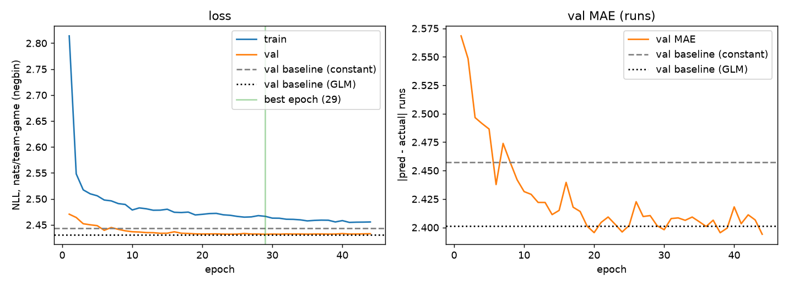

# basenet

How many runs a baseball team scores in a game is mostly noise. A team's score has a standard deviation of about 3.2
runs around a mean of about 4.5, and much of that variation is luck that no pre-game model can see. What's left depends
on who is playing: the batting order, the opposing starter and bullpen, the park and the weather.

This project asks whether a neural network that looks at each player individually predicts runs better than a linear
model on the same inputs.

We build a table of every MLB team-game from 2021 to 2025 (24,296 rows, two per game) from raw Statcast pitch data,
computing every feature only from games played before. We train a small neural network (BaseNet) that encodes the
nine-man batting order and the set of available pitchers, and outputs a negative binomial distribution over runs. We
compare it against a constant prediction and a linear count GLM, both using the same inputs and the same distribution.
We train on 2021–23, validate on 2024 and test on 2025.

We find that both learned models beat the constant, but BaseNet does not beat the GLM. Its predicted means are slightly
more accurate, but the GLM's predicted distribution fits the actual scores slightly better, in all 5 seeds. With about
15k training rows, the network's extra capacity finds nothing the linear model misses.



*One training run (seed 42) against the two baselines on the validation season. Early stopping keeps the best epoch.*

## Results

The main score is the negative log-likelihood (NLL) of the actual run total, which rewards the whole predicted
distribution, not just its mean. `exp(−NLL)` is the geometric-mean probability the model gave to the score that actually
happened. We also report the mean absolute error (MAE) of the predicted mean. All numbers are on the 2025 test season.
BaseNet is averaged over 5 seeds; the baselines are deterministic.

| Model | NLL (mean ± sd) | P(actual score) | MAE |
|---|---:|---:|---:|
| Constant | 2.4730 | 8.43% | 2.547 |
| Linear GLM | **2.4636** | **8.51%** | 2.526 |
| BaseNet | 2.4655 ± 0.0009 | 8.50% | **2.506 ± 0.004** |

- Both learned models beat the constant, by about 0.009 nats per team-game. The signal is small but real.
- BaseNet trails the GLM by 0.0019 ± 0.0009 nats, and the GLM is ahead on every seed.
- BaseNet has the lowest MAE on every seed. Its predicted means are better, but its predicted spread is not.
- The largest single improvement came from the distribution, not the model. Run totals vary about twice as much as
  their mean, which a Poisson model can't capture. Switching BaseNet from Poisson to negative binomial raised
  P(actual score) from 6.8% to 8.5%. The baselines use the same distribution, so this gain isn't credited to the
  network.

## Getting the labels and features right

Statcast's play-by-play misses runs that score on no plate appearance. A walk-off wild pitch, passed ball or balk ends
the game without a final event, so more than 30 games in 2021–25 looked like ties. Labels now come from the official MLB
StatsAPI scores, and every label is checked against Statcast's own run totals.

Every feature is computed in SQL windows that end strictly before the game, so the second game of a doubleheader sees
the first one. Player rates are shrunk toward a league average computed as of the previous day, so early-season
estimates never use later games. Splits are by whole season, and the scaler and park vocabulary are fit on training
data only. The tests check these rules by running the whole pipeline on a small synthetic season. `make validate`
repeats the label and row checks on the real data.

## How the model works

- **Hitters.** A 1-D convolution runs over the nine lineup slots with circular padding, because the order wraps from
  the 9th hitter back to the 1st. The slots are then averaged.
- **Pitchers.** A shared network encodes the starter and up to 12 available relievers. The bullpen is inferred from
  recent appearances and pitch counts, with rotation starters excluded. The pitchers are averaged with weights set by
  expected innings, and the starter is also kept as a separate input.
- **Output.** A head combines the hitters, the pitchers, the game context (weather included) and a learned embedding
  of the ballpark. It outputs the mean of a negative binomial with a learned dispersion.

Optional feature groups (contact quality, platoon splits, starter workload, schedule and travel, weather) can be
switched on in `configs.yaml`. On the 2024 validation season only platoon splits and weather helped both models, so
they are the default. Every column, and the time window it's computed over, is documented in [`DATA.md`](DATA.md).

## Limitations

- Lineups and starters are the ones that actually played. The model therefore knows about late scratches and pitching
  changes that a real pre-game forecast wouldn't.
- Bullpen availability is a heuristic, not the real roster.
- Five seasons is little data for a neural network. Adding 2015–19, or training on plate-appearance outcomes as well as
  final scores, would give the encoders far more to learn from.
- There's no comparison against betting-market run totals, the obvious external benchmark.

## Reproduce

```bash
pip install -e ".[dev]"   # Python 3.11+
make test                 # synthetic data, no network, ~30 s
make data                 # download Statcast + StatsAPI (~450 MB), then build and validate the table (~2 min)
make train                # one run -> runs/summary.json, runs/training_curve.png
make seeds                # 5 seeds -> runs/seeds/seeds_summary.json (the table above)
```

Data comes from [Baseball Savant](https://baseballsavant.mlb.com/) through
[pybaseball](https://github.com/jldbc/pybaseball), and from the MLB StatsAPI. None of it is redistributed here.

## License

MIT, see `LICENSE`.
